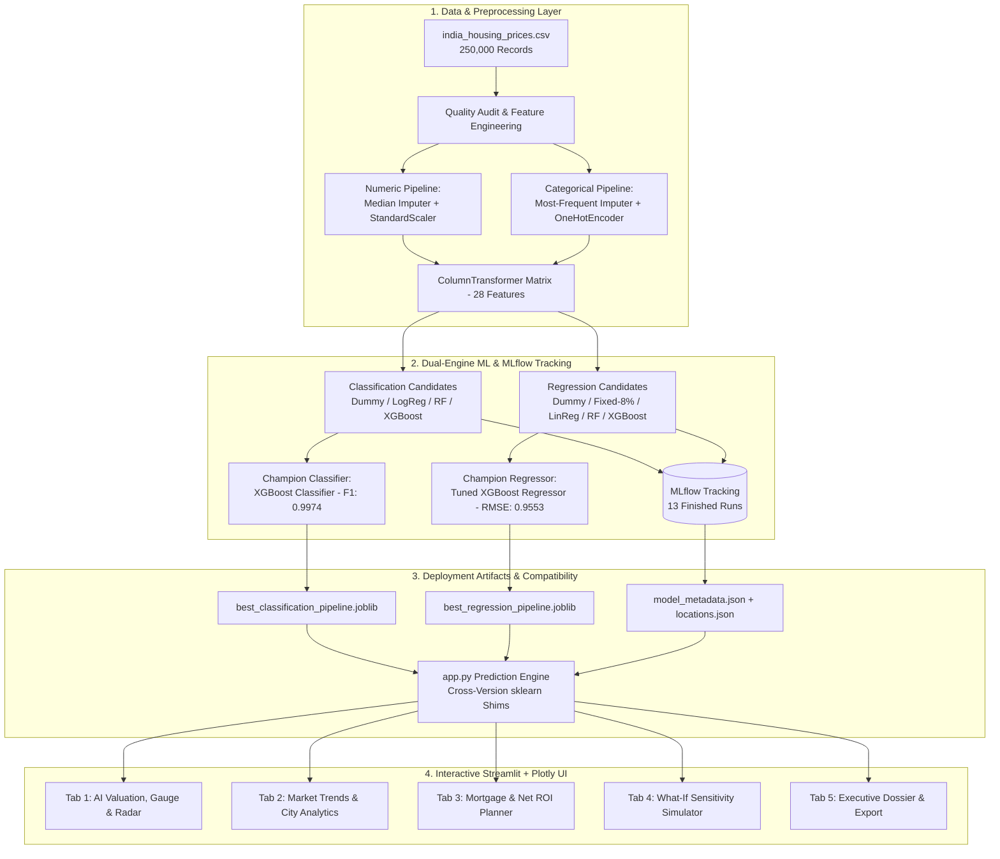
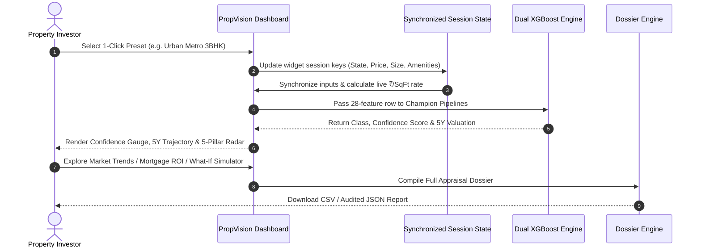

<div align="center">

# 🏢 PropVision AI — Real Estate Investment Advisor
### *Predicting Deal Profitability & 5-Year Capital Appreciation with Machine Learning*

[](https://2z42grgcd7qg5fwbqsdrso.streamlit.app/)
[](https://www.python.org/)
[](https://xgboost.ai/)
[](https://plotly.com/)
[](https://scikit-learn.org/)
[](https://mlflow.org/)
[](https://github.com/pvsairavish)

---

### 🌐 **Live Interactive Web Application**
👉 **[Launch PropVision AI on Streamlit Cloud](https://2z42grgcd7qg5fwbqsdrso.streamlit.app/)** 👈

</div>

---

## 📌 Table of Contents
- [Executive Summary](#-executive-summary)
- [Key Problems Addressed](#-key-problems-addressed)
- [System Architecture](#-system-architecture)
- [Data Quality & 20-Question EDA Findings](#-data-quality--20-question-eda-findings)
- [Machine Learning Dual-Engine & Benchmarks](#-machine-learning-dual-engine--benchmarks)
- [MLflow Experiment Tracking](#-mlflow-experiment-tracking)
- [Feature Engineering Pipeline](#-feature-engineering-pipeline)
- [Interactive UI / UX Design & Capabilities](#-interactive-ui--ux-design--capabilities)
- [Project Directory Structure](#-project-directory-structure)
- [Local Installation & Setup](#-local-installation--setup)
- [Author & Acknowledgements](#-author--acknowledgements)
- [License & Disclaimer](#-license--disclaimer)

---

## 🚀 Executive Summary

**PropVision AI** is an end-to-end PropTech and FinTech advisory platform built for residential property evaluation across India. Trained and validated on **250,000 housing records** spanning **20 states** and **42 cities**, the project combines a complete ML experimentation notebook ([`real-estate-investment-advisor.ipynb`](real-estate-investment-advisor.ipynb)) with a deployed Streamlit application ([`app.py`](app.py)) offering:

1. **AI Deal Viability Classification:** Classifies properties as **Good Investment** (`1`) or **Caution / Not Good** (`0`) with probability confidence scores, benchmarked against a Majority-Class Baseline, Logistic Regression, Random Forest, and XGBoost.
2. **5-Year Scenario Price Forecasting:** Estimates 5-year property value (in Indian Lakhs/Crores) and annual CAGR, benchmarked against Mean and Fixed-Growth (`8% p.a.`) baselines, Linear Regression, Random Forest, and XGBoost.
3. **5-Pillar Asset Health Radar:** Evaluates Transit Connectivity, Civic Infrastructure Density, Amenities Richness, Parking & Security, and Asset Modernity.
4. **Mortgage & Net Cashflow Modeling:** Computes monthly EMI, equity vs. debt breakdown, and 5-year net investor return factoring in rental income and interest outflow.
5. **Real-Time "What-If" Sensitivity Simulator & Dossier Export:** Stress-tests negotiation discounts and exports institutional CSV/JSON appraisal reports.

---

## 🔍 Key Problems Addressed

| Traditional Real Estate Appraisal | PropVision AI Solution |
| :--- | :--- |
| **Anecdotal & Subjective:** Reliance on broker claims without standardized criteria. | **Rule + ML Screening:** Consistent evaluation across 250k records and 28 engineered features. |
| **No Baseline Proof:** Models presented without checking simple heuristics or majority rules. | **Explicit Baselines:** Every model is benchmarked against Majority-Class (`DummyClassifier`), Mean (`DummyRegressor`), and Fixed `8% p.a.` growth rules. |
| **Static Price-per-SqFt:** Averages ignore floor ratio, society amenities, and transit distance. | **Multi-Dimensional Pipelines:** Combines numerical scaling and categorical encoding in unified `ColumnTransformer` pipelines. |
| **Disconnected Financing:** Valuation lacks loan and cashflow visibility. | **Integrated FinTech Planner:** Computes monthly EMI, interest drag, and net equity ROI. |

---

## 🏗️ System Architecture



---

## 📊 Data Quality & 20-Question EDA Findings

The notebook executes full data validation and **20 structured EDA visualizations** across all 250,000 listings:

- **Completeness & Cleaning:** **0** duplicate rows and **0** raw nulls. Detected **2,534** invalid `Price_per_SqFt = 0` entries and recalculated `Price_per_SqFt = Price_in_Lakhs / Size_in_SqFt`.
- **Synthetic Consistency Audit:** Identified **116,304** records where `Floor_No > Total_Floors`; handled safely via `Floor_Ratio` clipped to `[0, 1]`.
- **IQR Outlier Audit:** **0** outliers in `Price_in_Lakhs` (median **₹253.87L**, mean **₹254.59L**, range ₹10L–₹500L) and `Size_in_SqFt` (median **2,747 SqFt**); **20,020** upper-tail unit-rate outliers in `Price_per_SqFt` (> `0.3250` L/SqFt).
- **Market Structure:** Balanced geographic spread across 20 states (e.g., Odisha `12,681`, Tamil Nadu `12,629`, West Bengal `12,622`) and 42 cities (top average prices led by Bangalore **₹258.46L** and Surat **₹258.08L**). Near-zero raw linear correlation between `Size_in_SqFt` and `Price_in_Lakhs` (`r = -0.0025`), motivating nonlinear tree models.
- **Target Distributions:** `Good_Investment` is **61.82%** Not Good (`154,559`) vs **38.18%** Good (`95,441`); `Future_Price_5Y` spans **₹14.33L to ₹804.74L**.

---

## 🤖 Machine Learning Dual-Engine & Benchmarks

All models are evaluated on identical **80/20 splits** (`200,000` train / `50,000` test, `RANDOM_STATE = 42`) with **3-fold CV** and **RandomizedSearchCV** tuning, selecting champions strictly by evidence rather than default.

### 1. Classification Benchmarks (Target: `Good_Investment`)
*Selection Criterion: Highest test **F1-score** (tie-breaker: **ROC-AUC**)*

| Model | Accuracy | Precision | Recall | F1-Score | ROC-AUC |
| :--- | :---: | :---: | :---: | :---: | :---: |
| **🏆 XGBoost Classifier (Champion)** | **0.9980** | **0.9975** | **0.9972** | **0.9974** | **1.0000** |
| Tuned XGBoost Classifier | 0.9978 | 0.9974 | 0.9970 | 0.9972 | 1.0000 |
| Random Forest Classifier | 0.9469 | 0.8968 | 0.9728 | 0.9333 | 0.9952 |
| Logistic Regression | 0.9241 | 0.8769 | 0.9319 | 0.9036 | 0.9827 |
| Majority-Class Baseline (`DummyClassifier`) | 0.6182 | 0.0000 | 0.0000 | 0.0000 | 0.5000 |

- **3-Fold Stratified CV (XGBoost Classifier):** Accuracy `0.9974 ± 0.0002`, F1 `0.9967 ± 0.0002`.
- **Champion Selection Insight:** Untuned `XGBoost Classifier` (`n_estimators=250`, `max_depth=8`, `learning_rate=0.08`, `subsample=0.85`, `colsample_bytree=0.85`) outperformed the 5-iteration randomized search candidate (`F1 = 0.9974` vs `0.9972`), so the pipeline explicitly promoted the higher-scoring model.

### 2. Regression Benchmarks (Target: `Future_Price_5Y`)
*Selection Criterion: Lowest test **RMSE** (verified alongside **MAE** and **R²**)*

| Model | MAE (Lakhs) | RMSE (Lakhs) | R² |
| :--- | :---: | :---: | :---: |
| **🏆 Tuned XGBoost Regressor (Champion)** | **0.7973** | **0.9553** | **1.0000** |
| XGBoost Regressor | 0.8316 | 1.0229 | 1.0000 |
| Random Forest Regressor | 1.4622 | 1.7952 | 0.9999 |
| Linear Regression | 4.6285 | 6.3673 | 0.9991 |
| Fixed-Growth Baseline (`8% p.a.`) | 12.4940 | 17.4622 | 0.9933 |
| Mean Baseline (`DummyRegressor`) | 184.9056 | 213.6166 | -0.0000 |

- **Tuned Champion Parameters:** `n_estimators=200`, `max_depth=7`, `learning_rate=0.10`, `subsample=0.85`, `colsample_bytree=1.0`.
- **Diagnostics:** Verified via Actual-vs-Predicted scatter, Residuals-vs-Predicted, and Residual error distribution plots, beating the Fixed-Growth `8%` rule by **~94.5% reduction in RMSE** (`17.4622 → 0.9553`).

---

## 📈 MLflow Experiment Tracking

All **13 experiments** (`FINISHED`) are tracked in MLflow under experiment `Real_Estate_Investment_Advisor` (SQLite backend):

- **6 Classification Runs:** `classification_baseline_majority_class`, `classification_logistic_regression`, `classification_random_forest`, `classification_xgboost`, `classification_tuned_candidate`, and `classification_champion_selected` (`champion="true"`).
- **7 Regression Runs:** `regression_baseline_mean`, `regression_baseline_fixed_growth_8pct`, `regression_linear_regression`, `regression_random_forest`, `regression_xgboost`, `regression_tuned_candidate`, and `regression_champion_selected` (`champion="true"`).
- **Logged Artifacts:** Parameters, all classification/regression test metrics, serialized sklearn/XGBoost pipelines, and `classification_comparison.csv` / `regression_comparison.csv`.

---

## 🧪 Feature Engineering Pipeline

Raw inputs are transformed into **28 model features** (`16` numeric + `12` categorical), excluding identifiers (`ID`, `Locality`) and target-construction columns (`Investment_Score`, `Price_vs_City_Median`, `PPSqFt_vs_City_Median`, `Annual_Appreciation_Rate`):

| Feature Name | Type | Description & Definition |
| :--- | :--- | :--- |
| `Price_per_SqFt` | Numeric | $\frac{\text{Price in Lakhs}}{\text{Size in SqFt}}$ |
| `Floor_Ratio` | Numeric | $\text{clip}\left(\frac{\text{Floor No}}{\text{Total Floors}}, 0, 1\right)$ |
| `School_Hospital_Access` | Numeric | $\text{Nearby Schools} + \text{Nearby Hospitals}$ |
| `Amenities_Count` | Numeric | Count of society amenities (`Clubhouse`, `Garden`, `Gym`, `Playground`, `Pool`) |
| `Property_Age_Band` | Categorical | `New` (≤5y), `Moderate` (6–15y), `Old` (16–25y), `Very_Old` (>25y) |
| `Has_Parking`, `Has_Security`, `Is_Ready_To_Move` | Binary | `1` / `0` flags mapped from availability, security, and parking status |

---

## 🎨 Interactive UI / UX Design & Capabilities



- **Tab 1 — 🔮 AI Investment Advisor:** 1-click curated presets, cascading State → City dropdowns, live `₹/SqFt` pill, Plotly Investment Confidence Gauge, 5-Year Trajectory vs 7% benchmark, and 5-Pillar Asset Health Radar.
- **Tab 2 — 📊 Market Trends & Analytics:** Interactive filtering over `india_housing_prices.csv` with city-level price rankings and property-type box plots.
- **Tab 3 — 💰 Mortgage & ROI Planner:** Down payment, interest rate, and tenure sliders computing monthly EMI $\text{EMI} = \frac{P \cdot r \cdot (1 + r)^n}{(1 + r)^n - 1}$, financing donut chart, and 5-year net investor gain.
- **Tab 4 — ⚖️ What-If Comparison:** Negotiation discount slider (`-25%` to `+25%`), floor/readiness toggles, and side-by-side delta comparison charts.
- **Tab 5 — 📋 Investment Dossier:** Appraisal summary table with one-click **CSV** and **JSON** downloads.

---

## 📂 Project Directory Structure

```
Real-Estate-Investment-Advisor/
│
├── app.py                                 # Streamlit application with Plotly UI/UX
├── real-estate-investment-advisor.ipynb   # Executed EDA, Baselines, MLflow & Training Notebook
├── india_housing_prices.csv               # Source dataset (250,000 housing records)
├── locations.json                         # State-to-city mapping (20 states, 42 cities)
├── requirements.txt                       # Streamlit deployment dependencies
├── README.md                              # Project documentation & benchmark report
│
└── models/
    ├── best_classification_pipeline.joblib  # Champion XGBoost Classifier pipeline
    ├── best_regression_pipeline.joblib      # Champion Tuned XGBoost Regressor pipeline
    ├── locations.json                       # Location taxonomy copy
    └── model_metadata.json                  # Champion parameters & benchmark comparison tables
```

---

## 💻 Local Installation & Setup

### 1. Clone the Repository
```bash
git clone https://github.com/pvsairavish/Real-Estate-Investment-Advisor-Predicting-Property-Profitability-Future-Value.git
cd Real-Estate-Investment-Advisor-Predicting-Property-Profitability-Future-Value
```

### 2. Create and Activate Virtual Environment
```bash
# Windows (PowerShell)
python -m venv venv
.\venv\Scripts\Activate.ps1

# macOS / Linux
python3 -m venv venv
source venv/bin/activate
```

### 3. Install Dependencies
```bash
# For running the Streamlit app
pip install -r requirements.txt

# Optional: additional packages to re-run the full training notebook
pip install matplotlib seaborn mlflow h5py ipykernel
```

### 4. Run the Streamlit Application
```bash
streamlit run app.py
```
Open your browser at `http://localhost:8501`.

---

## 👨‍💻 Author & Acknowledgements

**Venkata Sai Ravish Punati**  
- **GitHub:** [@pvsairavish](https://github.com/pvsairavish)  
- **Repository:** [Real-Estate-Investment-Advisor](https://github.com/pvsairavish/Real-Estate-Investment-Advisor-Predicting-Property-Profitability-Future-Value)  
- **Email:** punatiravish@gmail.com  
- **Live App:** [https://2z42grgcd7qg5fwbqsdrso.streamlit.app/](https://2z42grgcd7qg5fwbqsdrso.streamlit.app/)

---

## ⚖️ License & Disclaimer

*Educational & Analytical Disclaimer: `Good_Investment` and `Future_Price_5Y` are rule- and scenario-engineered targets constructed because the source dataset does not contain observed future sale prices. Model outputs represent algorithmic scenario estimates rather than real-world longitudinal validation and should not be construed as financial, investment, or legal advice.*
