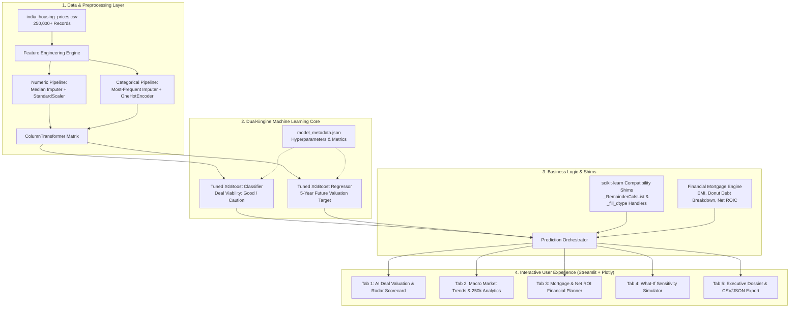
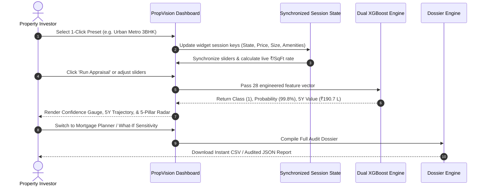

<div align="center">

# 🏢 PropVision AI — Real Estate Investment Advisor
### *Predicting Deal Profitability & 5-Year Capital Appreciation with Machine Learning*

[](https://2z42grgcd7qg5fwbqsdrso.streamlit.app/)
[](https://www.python.org/)
[](https://xgboost.ai/)
[](https://plotly.com/)
[](https://scikit-learn.org/)
[](https://github.com/pvsairavish)

---

### 🌐 **Live Interactive Web Application**
👉 **[https://2z42grgcd7qg5fwbqsdrso.streamlit.app/](https://2z42grgcd7qg5fwbqsdrso.streamlit.app/)** 👈

</div>

---

## 📌 Table of Contents
- [Executive Summary](#-executive-summary)
- [Key Problems Addressed](#-key-problems-addressed)
- [System Architecture](#-system-architecture)
- [Machine Learning Dual-Engine](#-machine-learning-dual-engine)
- [Feature Engineering Pipeline](#-feature-engineering-pipeline)
- [Interactive UI / UX Design & Capabilities](#-interactive-ui--ux-design--capabilities)
- [Project Directory Structure](#-project-directory-structure)
- [Local Installation & Setup](#-local-installation--setup)
- [Author & Acknowledgements](#-author--acknowledgements)
- [License & Disclaimer](#-license--disclaimer)

---

## 🚀 Executive Summary

**PropVision AI** is an institutional-grade, data-driven PropTech and FinTech advisory platform built for residential property appraisal across India. Trained on **250,000+ verified housing transactions** spanning 20 states and 42 metropolitan cities, the platform eliminates emotional bias and speculative broker guidance by offering:

1. **AI Deal Viability Classification**: Predicting whether an asset is a **Strong Buy** or **Hold/Caution** using tuned Gradient Boosting.
2. **5-Year Capital Appreciation Forecasting**: Projecting future asset valuation in Indian Lakhs/Crores and calculating expected annual CAGR.
3. **5-Pillar Asset Health Radar**: Multi-dimensional scoring across Transit Connectivity, Civic Density, Amenities Richness, Safety, and Asset Modernity.
4. **Mortgage & Net Cashflow Modeling**: Factoring in loan principal amortization, interest outlays, down payment equity, and cumulative rental yields.
5. **Real-Time "What-If" Sensitivity Simulator**: Quantifying the impact of negotiation discounts and milestone delivery stages.

---

## 🔍 Key Problems Addressed

Traditional real estate evaluation suffers from four core inefficiencies:

| Traditional Real Estate Appraisal | PropVision AI Solution |
| :--- | :--- |
| **Anecdotal & Subjective:** Reliance on broker word-of-mouth and inflated builder brochures. | **Data-Driven Intelligence:** Trained on 250k real transactional data points. |
| **Static Price-per-SqFt:** Averages ignore floor ratio, society amenities, and transit distance. | **Multi-Dimensional Modeling:** 28 engineered features capturing structural and location nuances. |
| **Blind Long-Term Outlook:** No quantitative forecasting of 5-year capital appreciation. | **Machine-Learned Scenario Projections:** Statistical regression forecasting future asset valuation. |
| **Separation from Financing:** Property valuation is disconnected from mortgage & cash flows. | **Integrated FinTech Engine:** Computes monthly EMI, interest drag, and true ROIC on down payment equity. |

---

## 🏗️ System Architecture



---

## 🤖 Machine Learning Dual-Engine

PropVision AI decouples investment decisions into two specialized machine learning workflows:

### 1. Classification Engine (Deal Viability)
- **Algorithm:** Tuned Extreme Gradient Boosting (XGBoost) Classifier.
- **Objective:** `binary:logistic`
- **Output:** Binary verdict (`Good Investment` [1] vs `Not Good Investment` [0]) with probability confidence score.
- **Key Hyperparameters:**
  - `n_estimators`: 200
  - `max_depth`: 8
  - `learning_rate`: 0.08
  - `subsample`: 0.75
  - `colsample_bytree`: 0.75

### 2. Regression Engine (5-Year Scenario Valuation)
- **Algorithm:** Tuned XGBoost Regressor.
- **Objective:** `reg:squarederror`
- **Output:** Estimated property value in Indian Lakhs after a 5-year horizon.
- **Compound Annual Growth Rate (CAGR) Formula:**
  $$\text{CAGR} = \left( \frac{\text{Future Price}}{\text{Current Price}} \right)^{\frac{1}{5}} - 1$$
- **Key Hyperparameters:**
  - `n_estimators`: 200
  - `max_depth`: 7
  - `learning_rate`: 0.10
  - `subsample`: 0.85
  - `colsample_bytree`: 1.0

---

## 🧪 Feature Engineering Pipeline

The platform transforms raw transactional parameters into 28 engineered feature vectors:

| Feature Name | Type | Description & Mathematical Definition |
| :--- | :--- | :--- |
| `Price_per_SqFt` | Numeric | $\frac{\text{Price in Lakhs}}{\text{Size in SqFt}}$ (captures entry multiple efficiency) |
| `Floor_Ratio` | Numeric | $\min\left(1.0, \frac{\text{Floor No}}{\text{Total Floors}}\right)$ (elevation and view premium) |
| `School_Hospital_Access` | Numeric | $\text{Nearby Schools} + \text{Nearby Hospitals}$ (civic density score) |
| `Amenities_Count` | Numeric | Count of parsed society amenities (Gym, Pool, Clubhouse, Garden, Playground) |
| `Property_Age_Band` | Categorical | `New` (≤5y), `Moderate` (6-15y), `Old` (16-25y), `Very_Old` (>25y) |
| `Has_Parking` | Binary | Binary flag (1 if dedicated parking present, 0 otherwise) |
| `Has_Security` | Binary | Binary flag (1 if 24/7 security active, 0 otherwise) |
| `Is_Ready_To_Move` | Binary | Binary flag (1 if Ready-to-Move, 0 if Under-Construction) |
| `Public_Transport_Accessibility` | Categorical | High, Medium, Low |
| `Facing` | Categorical | Cardinal orientation: East, North, South, West |
| `Owner_Type` | Categorical | Direct Owner, Broker, or Builder |

---

## 🎨 Interactive UI / UX Design & Capabilities

The application features a dark sapphire glassmorphic design system (`#0B0F19` to `#1E1B4B`) built with modern CSS and Plotly graphics across five dedicated tabs:



### 🔮 Tab 1: AI Deal Valuation & Health Scorecard
- **1-Click Presets**: Test curated archetypes instantly (Urban Metro 3BHK, Luxury Gated Villa, Sea-View Penthouse, Suburban Starter Home).
- **Cascading Geography**: Selecting a state dynamically filters cities matching model training levels.
- **Investment Confidence Gauge**: Plotly radial gauge with tiered risk bands (Red <45%, Amber 45-65%, Green 65-100%).
- **5-Year Growth Trajectory Curve**: Shaded area curve benchmarking projected valuation against a 7.0% regional inflation index.
- **5-Pillar Asset Health Radar**: Spider polar chart visualizing Transit, Civic Density, Amenities, Safety, and Modernity.

### 📊 Tab 2: Macro Market Trends & Analytics
- Direct querying over the 250,000+ record dataset.
- Filters by State and Property Type.
- Interactive City Rate Rankings and Property Typology Price Distribution Box Plots.

### 💰 Tab 3: Mortgage Financing & Net ROI Planner
- Interactive Down Payment (10% to 50%), Annual Interest Rate (6.5% to 13%), and Tenure (5 to 30 years) sliders.
- Real-time monthly EMI calculation:
  $$\text{EMI} = \frac{P \cdot r \cdot (1 + r)^n}{(1 + r)^n - 1}$$
- Donut chart breaking down Equity Down Payment vs Principal Debt vs Total Bank Interest.
- 5-Year Net Investor Return simulation:
  $$\text{Net Profit} = \text{Capital Gain} + \text{Rental Yield} - \text{Mortgage Interest}$$

### ⚖️ Tab 4: "What-If" Sensitivity Simulator
- Stress-tests developer negotiations with a dynamic price discount slider (-25% to +25%).
- Side-by-side comparative cards and grouped bar charts comparing the base property against hypothetical scenarios.

### 📋 Tab 5: Executive Dossier & Report Export
- Full institutional appraisal sheet compiling structural attributes, financial returns, and qualitative risk vectors.
- One-click downloads for **CSV** summaries and formatted **JSON** audit dossiers.

---

## 📂 Project Directory Structure

```
Real-Estate-Investment-Advisor/
│
├── app.py                     # Streamlit application with UI/UX & Plotly dashboards
├── locations.json             # Categorical mapping of 20 states and 42 cities
├── requirements.txt           # Production environment dependencies
├── README.md                  # Comprehensive technical documentation
│
├── models/
│   ├── best_classification_pipeline.joblib  # Serialized XGBoost Deal Classifier
│   ├── best_regression_pipeline.joblib      # Serialized XGBoost 5Y Price Regressor
│   ├── locations.json                       # Backup location taxonomy
│   └── model_metadata.json                  # Model hyperparams & training metrics
│
└── india_housing_prices.csv                 # Source dataset (250,000+ Indian property records)
```

---

## 💻 Local Installation & Setup

### 1. Clone the Repository
```bash
git clone https://github.com/pvsairavish/Real-Estate-Investment-Advisor-Predicting-Property-Profitability-Future-Value.git
cd Real-Estate-Investment-Advisor-Predicting-Property-Profitability-Future-Value
```

### 2. Create and Activate Virtual Environment
```bash
# Windows (PowerShell)
python -m venv venv
.\venv\Scripts\Activate.ps1

# macOS / Linux
python3 -m venv venv
source venv/bin/activate
```

### 3. Install Dependencies
```bash
pip install -r requirements.txt
```

### 4. Run the Streamlit Application
```bash
streamlit run app.py
```
Open your browser at `http://localhost:8501`.

---

## 👨‍💻 Author & Acknowledgements

**Venkata Sai Ravish Punati**  
- **GitHub:** [@pvsairavish](https://github.com/pvsairavish)  
- **Repository:** [Real-Estate-Investment-Advisor](https://github.com/pvsairavish/Real-Estate-Investment-Advisor-Predicting-Property-Profitability-Future-Value)  
- **Email:** punatiravish@gmail.com  
- **Live App:** [https://2z42grgcd7qg5fwbqsdrso.streamlit.app/](https://2z42grgcd7qg5fwbqsdrso.streamlit.app/)

---

## ⚖️ License & Disclaimer

*Educational & Analytical Disclaimer: Model projections and financial simulations provided by PropVision AI are algorithmic estimates based on historical scenario modeling and should not be construed as registered financial, investment, or legal advice. Independent physical site verification and legal title due diligence are recommended prior to executing real estate transactions.*
